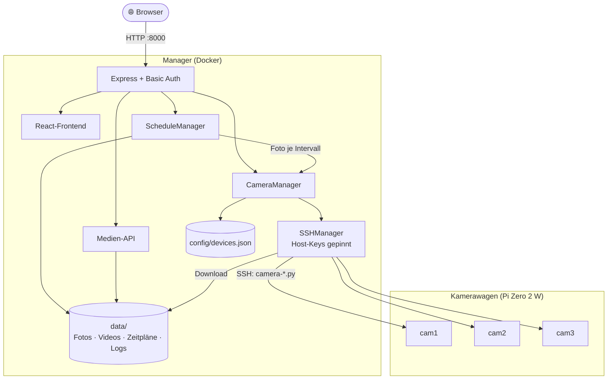
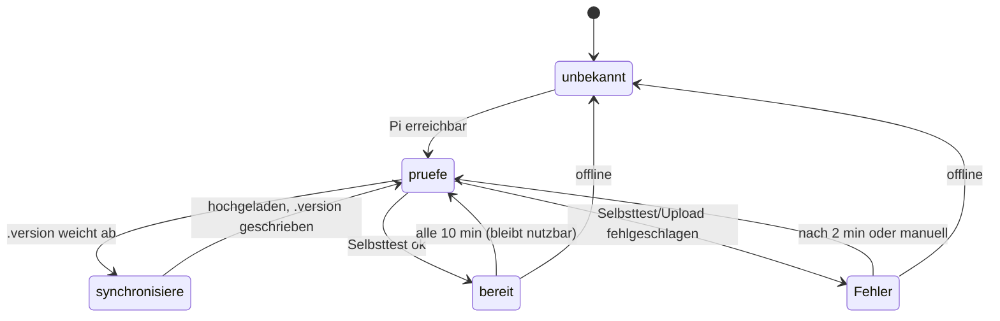
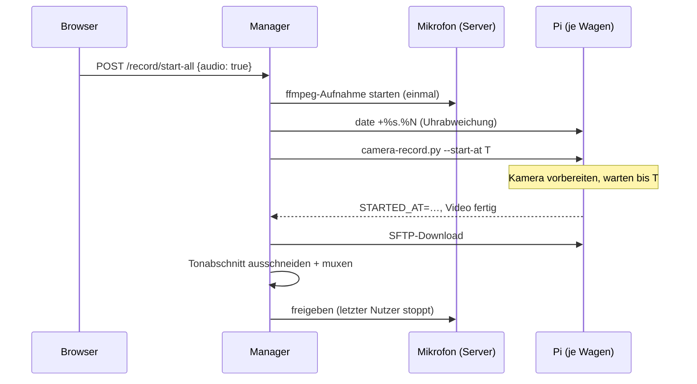

# Architektur

Auf den Pis läuft kein eigener Dienst. Der Manager ruft per SSH die Python-Skripte aus `scripts/` auf und lädt die Datei danach per SFTP herunter.

## Backend (`src/backend`)

| Modul | Aufgabe |
|---|---|
| `config.ts` | Alle Einstellungen aus der Umgebung (`.env`), Pfade unter `config/` und `data/` |
| `app.ts` / `index.ts` | Express-App (Auth, Routen, SPA, Fehlerbehandlung) bzw. Serverstart und Shutdown |
| `validation.ts` | Joi-Schemas für alle Eingaben, `HttpError` |
| `middleware/auth.ts` | HTTP Basic Auth (zeitkonstanter Vergleich), `/health` bleibt frei |
| `services/SSHManager.ts` | Verbindungspool pro Ziel, parallele Verbindungsaufbauten werden zusammengeführt, TOFU-Host-Key-Prüfung (`data/known_hosts.json`) |
| `services/CameraManager.ts` | Kameras aus `devices.json`, Statusprüfung alle 30 s (parallel, 5 s Timeout), Foto/Video, Sperre pro Kamera |
| `services/RecordingManager.ts` | Aufnahme-Sessions (warten → aufnehmen → stoppen → Ton hinzufügen → fertig), räumt alte Sessions auf |
| `services/ScriptSync.ts` | Kamera-Skripte auf die Pis verteilen (Versionsvergleich, Upload, Selbsttest) |
| `services/AudioRecorder.ts` | Gemeinsame Mikrofon-Aufnahme per ffmpeg (Referenzzählung), Ton ins Video muxen |
| `services/ScheduleManager.ts` | Zeitpläne mit echtem Intervall-Timer, persistiert in `data/schedules.json` |
| `services/timeWindow.ts` | Zeitfenster-Logik (inkl. über Mitternacht) |
| `routes/media.ts` | Gemeinsamer Router für Foto- und Video-Dateien: Liste, Inline-Ansicht, Download, Vorschaubild, Löschen |
| `utils/shell.ts` | Quoting aller Argumente für Remote-Befehle |
| `metrics.ts` | Prometheus-Metriken (`prom-client`): Zähler/Histogramme für Aufnahmen, Fotos, SSH, API; Kamerastatus und Speicher werden beim Abruf gelesen. Eigener Port `METRICS_PORT` (9464) |

### Sicherheit

- **Eingaben**: Jede Route validiert ihren Body mit Joi, unbekannte Felder werden entfernt. Zusätzlich gehen alle Werte durch `shellQuote`, bevor sie in einen Remote-Befehl eingesetzt werden. Beides zusammen verhindert Command Injection.
- **Ziele**: SSH-Verbindungen gibt es nur zu Kameras aus `devices.json`. Die Diagnose nimmt eine Kamera-ID, keinen Host.
- **Dateien**: Dateinamen werden gegen ein striktes Muster und die erlaubten Endungen geprüft, das verhindert Path Traversal.
- **Container**: läuft als unprivilegierter User. Gemountet wird nur der eine private Key (read-only), nicht `~/.ssh`.
- **Metriken**: `/metrics` läuft auf einem eigenen Port ohne Login. Im Container ist er nur im Compose-Netz erreichbar (`expose`, kein `ports`), Prometheus fragt ihn dort ab. Grafana hat einen eigenen Login (`GRAFANA_ADMIN_PASSWORD`).
- **Login**: Basic Auth. Über ein unverschlüsseltes Netz geht das Passwort im Klartext. Im Heimnetz ist das vertretbar, für Zugriff von außen gehört ein Reverse Proxy mit TLS davor.

### Kamera-Zugriff

Ein Kameramodul kann nur von einem Prozess gleichzeitig benutzt werden. `CameraManager.withLock` serialisiert deshalb alle Zugriffe pro Kamera:

- Fotos (manuell oder per Zeitplan) warten in der Warteschlange.
- Ein Video hält die Sperre bis zum Ende des Downloads.
- Ein Foto während einer Videoaufnahme wird mit `409` abgelehnt, statt bis zu einer Stunde zu warten.

## Abläufe

### Nachbearbeitung jedes Videos (`videoFinalize.ts`)

Die Pis schreiben die echten Sensor-Zeitstempel. Die schwanken minimal, und die Standard-Zeitbasis von PyAV (1/12288) kann 1/30 s nicht exakt darstellen. Schnittprogramme wie Kdenlive melden deshalb „variable Bildwiederholfrequenz“. Darum bearbeitet der Server jedes Video nach dem Download nach. Das läuft auf dem Manager-Rechner, nicht auf dem Pi:

1. `ffprobe` prüft die Bildabstände. Ein Bild gilt als verloren, wenn ein Abstand größer als 1,5 Bilddauern ist.
2. Gehen keine Bilder verloren, wird der H.264-Strom als Rohdatenstrom neu verpackt, mit `-framerate 30` und Track-Zeitbasis 1/30. Jedes Bild dauert dann exakt einen Tick, und `avg_frame_rate = r_frame_rate = 30/1`. Das Rotations-Flag für 90°/270° wird dabei neu gesetzt.
3. Optional kommt der Ton in einem eigenen Durchgang dazu. Ein Rohdatenstrom hat keine Paket-Zeitstempel, `-shortest` würde den Ton sonst auf null kürzen.
4. Gehen Bilder verloren, wird das Video neu kodiert (`-vf fps=30`, libx264, `VIDEO_CRF` 18, `VIDEO_PRESET` veryfast). Für jedes fehlende Bild wird das vorherige wiederholt. Die Zeitachse bleibt dabei unverändert, Bild und Ton bleiben synchron, und das Ergebnis hat konstante 30 fps. Ein 90°/270°-Flag wird dabei zu gedrehten Pixeln. Auf einem Laptop dauert das etwa 1/10 der Videolänge, auf einem Pi 5 eher so lange wie das Video. Die Session zeigt einen Hinweis.
5. Mit `VFR_REENCODE=off` bleiben bei verlorenen Bildern stattdessen die originalen Zeitstempel erhalten (variable Bildrate, keine Neukodierung).

Auf den Pis landen die Aufnahmen in `~/modellbahn-kamera-linux/tmp` auf der SD-Karte und nicht in `/tmp`. Dort ist unter Debian trixie ein RAM-Dateisystem mit etwa 200 MB auf dem Zero, das für längere Videos nicht reicht.

### Skript-Abgleich und Status „bereit“

- Die Version ist ein SHA-256 über Namen und Inhalt aller Pi-Skripte im Image (`scripts/`).
- Beim Upload entstehen erst `.new`-Dateien, dann folgt das Umbenennen, `.version` kommt zuletzt. Bricht der Upload ab, bleibt die alte Version stehen, und der nächste Durchlauf wiederholt ihn.
- Der Abgleich hält die Kamera-Sperre, er läuft also nie während einer Aufnahme.
- Fotos, Videos, Zeitpläne und „Alle aufnehmen“ verlangen den Status `ready`. Andernfalls antwortet der Server mit `409` samt Grund, bzw. der Wagen wird übersprungen.

### Foto

1. `POST /api/cameras/cam1/capture`: Body validieren
2. Sperre für `cam1` holen
3. SSH: `exec timeout -k 10 30 python3 …/camera-capture.py --output /tmp/kamera_<uuid>.jpg …`
4. Das Skript schreibt zusätzlich ein Vorschaubild (`--thumbnail`, 480 px, Pillow)
5. SFTP-Download nach `data/photos/<Kamera>_<UTC>.jpg` und `data/thumbnails/photos/…jpg`, danach die Remote-Dateien löschen. Fehlt das Vorschaubild, bleibt die Aufnahme trotzdem gültig

### Video und Stopp

1. `record/start` legt eine Session an, setzt den Status `recording` und startet den Remote-Befehl im Hintergrund. Die HTTP-Antwort kommt sofort.
2. `camera-record.py` nimmt `--duration` Sekunden auf.
3. `record/stop` schickt `pkill -INT -f "[c]amera-record.py --output <datei>"`. Das Skript fängt SIGINT ab und schließt die MP4-Datei sauber, der Remote-Befehl endet mit Exit-Code 0.
4. Nach der Aufnahme zieht ffmpeg bei 0,5 s ein Einzelbild als Vorschau heraus, mit Rotation
5. Der Hintergrund-Job lädt Video und Vorschau herunter, markiert die Session als `completed` und setzt den Status wieder auf `online`.

Harte Grenzen: Das Skript hat einen eigenen Alarm (`--timeout`). Zusätzlich beendet `timeout -k 10` den Prozess, falls er hängt.

### Alle Kamerawagen gleichzeitig (mit Ton)

1. `record/start-all` legt eine Startzeit fest (jetzt + `START_LEAD_SECONDS`, Standard 7 s) und startet für jeden erreichbaren Wagen eine Aufnahme. Offline-Wagen werden übersprungen und gemeldet.
2. Mit Ton startet der `AudioRecorder` eine einzige ffmpeg-Aufnahme des Server-Mikrofons (PulseAudio/PipeWire oder ALSA). Sie bedient alle Wagen, gezählt wird per Referenz. Geschrieben wird rohes PCM, so lässt sich jeder Zeitabschnitt schon während der laufenden Aufnahme ausschneiden. Wann das erste Sample entstand, berechnet der Server aus der Datenmenge.
3. Pro Wagen misst der `SSHManager` die Uhrabweichung Pi ↔ Server, NTP-artig über die Laufzeit von `date +%s.%N`. Die Startzeit wird in die Uhrzeit des Pis umgerechnet und als `--start-at` übergeben.
4. `camera-record.py` bereitet Kamera und Encoder vor, wartet bis zur Startzeit und gibt die Zeit des ersten Bildes als `STARTED_AT=…` aus, ermittelt aus dem Sensor-Zeitstempel. Daraus berechnet der Server die Abweichung zum geplanten Start („Start +13 ms“ in der Oberfläche).
5. Nach dem Download schneidet ffmpeg den passenden Abschnitt aus der Tonaufnahme und fügt ihn als AAC ein. Das Video wird kopiert, nicht neu kodiert, `+faststart` sorgt fürs Streaming. Das passiert erst, nachdem die Kamera wieder frei ist (siehe „Nachbearbeitung“).
6. Der letzte Nutzer gibt das Mikrofon frei. Die Aufnahme endet, die temporäre Datei unter `data/audio-tmp/` wird gelöscht.

Ton funktioniert genauso bei Einzelaufnahmen (`audio: true`).

### Zeitplan

- Beim Aktivieren: sofort ein Durchlauf, danach `setInterval(interval)`.
- Jeder Tick prüft das Zeitfenster und überspringt, solange der vorige Durchlauf noch läuft.
- Alle Kameras des Plans nehmen parallel auf (`Promise.allSettled`). Fehler einzelner Kameras landen in `lastError`, der Plan läuft weiter.
- Beim Serverstart werden aktive Pläne aus `data/schedules.json` wieder gestartet.

## Pi-Skripte (`scripts/`)

| Datei | Zweck |
|---|---|
| `camera_common.py` | Rotation, ROI → `ScalerCrop`, Autofokus, HDR, gemeinsame Argumente |
| `camera-capture.py` | Foto: Autofokus und Belichtung in schneller Vorschau-Auflösung, dann Umschalten in den Still-Modus nur für die Aufnahme (12 MP in ~4–8 s statt Timeout) |
| `camera-record.py` | Video H.264 → MP4 im eigenen Prozess via PyAV mit echten Zeitstempeln (Fallback: externes ffmpeg), sauberer Stopp bei SIGINT/SIGTERM |
| `setup-rpi-zero.sh` | Pakete (`python3-picamera2`, `python3-av`, `python3-pil`, `ffmpeg`, `v4l-utils`, …) und Kamera-Check |
| `test-camera.sh` | Schnelltest direkt auf dem Pi |
| `deploy-cameras.sh` | Skripte auf alle Pis aus `devices.json` kopieren, optional Setup |
| `deploy-rpi5.sh` | Manager auf den Pi 5 synchronisieren und dort bauen |

**Rotation**: 180° übernimmt der ISP (`Transform(hflip, vflip)`) ohne Rechenaufwand. 90°/270° kann der ISP nicht. Fotos dreht deshalb Pillow nach der Aufnahme. Aus 1920×1080 wird dabei ein Hochformat-Foto mit 1080×1920, denn die Auflösung bezieht sich immer auf den Sensor. Videos bekommen ein Rotations-Flag im MP4-Container (ohne Neukodierung, das ist auf dem Zero 2 W zu langsam), und der Player dreht beim Abspielen.

**ROI**: Die Angabe bezieht sich auf das fertige (gedrehte) Bild. Bei 90°/270° wird sie in Sensor-Koordinaten zurückgerechnet. Bei 180° ist das nicht nötig, weil `ScalerCrop` die Sensor-Spiegelung schon berücksichtigt (auf Camera Module 3 geprüft). `ScalerCrop` wird erst nach `configure()` gesetzt und auf das Seitenverhältnis der Ausgabe erweitert, damit das Bild nicht verzerrt.

**Autofokus/HDR**: werden nur gesetzt, wenn die Kamera sie unterstützt (Camera Module 3). Sonst schreibt das Skript eine Warnung nach stderr und macht ohne weiter.

## Frontend (`frontend/`)

Fotos und Videos zeigt die gemeinsame Komponente `MediaGallery`: Vorschaubilder im Raster, Klick öffnet die Großansicht (Foto oder Video-Player, ←/→ blättern, Esc schließt). Ältere Aufnahmen ohne Vorschaubild zeigt der Browser direkt (Foto verkleinert, Video mit dem Bild bei 0,5 s). Kann ein Browser kein H.264 abspielen, erscheint ein Hinweis mit Download-Knopf.

React 18, Vite, Tailwind, Zustand. Die Typen kommen aus `src/shared/types.ts` (Alias `@shared`, nur `import type`). Der Kamerastatus wird alle 5 s abgefragt. Die ausgewählte Kamera wird über die ID aus dem Store gelesen, damit Status wie „recording“ immer aktuell sind.

## Tests

`vitest` unter `src/**/*.test.ts`:

- Shell-Quoting (gegen eine echte Shell geprüft) und Befehlsaufbau
- Validierung
- Zeitfenster
- ScheduleManager (Fake-Timer, Persistenz)
- Basic Auth
- Media-Routen (Traversal, Löschen)

Die CI (`.github/workflows/build.yml`) führt Lint, Typecheck, Tests und Build für Node 20 und 22 aus, außerdem Python-Syntaxcheck und ShellCheck. Auf `main` baut sie das Multi-Arch-Image nach GHCR.
