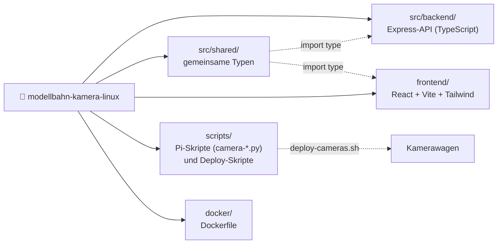

# Modellbahn Kamera Manager

Zentrale Web-Oberfläche für die Kamerawagen einer Modellbahn: mehrere Raspberry Pi Zero 2 W mit Kamera-Modul werden per SSH gesteuert. Der Manager läuft als Docker-Container auf einem PC (amd64) oder einem Raspberry Pi 5 (arm64).

- 📸 Fotos und 🎥 Videos pro Kamera auslösen, Video-Aufnahmen vorzeitig stoppen
- ⏱️ Zeitpläne: alle 1–10 Minuten Fotos, optional nur in einem Zeitfenster (auch über Mitternacht), bleiben über Neustarts erhalten
- 🔄 Rotation pro Kamera (getrennt für Foto/Video), ROI/Zoom, Autofokus und HDR (Camera Module 3)
- 🗂️ Galerie mit Vorschaubildern, Großansicht für Fotos, Video-Player im Browser, herunterladen, löschen
- 🔧 SSH-Diagnose mit Hinweisen zur Fehlerbehebung
- 🔐 Login per HTTP Basic Auth, Host-Key-Pinning für die SSH-Verbindungen

Aufbau und Datenfluss: siehe [ARCHITECTURE.md](ARCHITECTURE.md).

## Schnellstart

### 1. SSH-Schlüssel für die Kameras

Am besten ein eigener Schlüssel nur für die Kamerawagen:

```bash
ssh-keygen -t ed25519 -f ~/.ssh/kamera_ed25519 -N ''
ssh-copy-id -i ~/.ssh/kamera_ed25519.pub pi@192.168.1.101   # für jeden Pi
```

### 2. Konfiguration

```bash
cp .env.example .env                                  # SSH_KEY_FILE, AUTH_PASSWORD setzen
cp config/devices.json.example config/devices.json    # Kameras eintragen
```

Wichtige Einstellungen in `.env`:

| Variable | Bedeutung |
|---|---|
| `SSH_KEY_FILE` | Pfad zum privaten Kamera-Key **auf dem Host** (wird read-only in den Container gemountet) |
| `AUTH_USER` / `AUTH_PASSWORD` | Login für die Weboberfläche. Leer = kein Login (nicht empfohlen) |
| `HOST_PORT` | Port der Weboberfläche auf dem Host (Standard 8000) |
| `APP_UID` / `APP_GID` | Besitzer von `config/`, `data/` und dem Key (`id -u`, `id -g`) |
| `SSH_HOST_KEY_CHECK` | `tofu` (Standard): Host-Key beim ersten Kontakt merken, Änderungen ablehnen |

### 3. Kamerawagen einrichten

```bash
make setup-cameras     # Skripte kopieren + Pakete installieren (sudo fragt nach dem Passwort)
make deploy-cameras    # später: nur die Skripte aktualisieren
```

Die Kameras werden aus `config/devices.json` gelesen (`jq` wird benötigt). Auf den Pis landen nur die Kamera-Skripte unter `~/modellbahn-kamera-linux/scripts/`.

### 4. Manager starten

```bash
make up                # = docker compose up -d --build
```

Weboberfläche: <http://localhost:8000>

Auf dem Raspberry Pi 5 (Build direkt auf dem Pi):

```bash
make deploy-rpi5       # rsync + docker compose up -d --build auf raspberrypi-5-ai-had
```

`.env`, `config/devices.json` und `data/` auf dem Ziel bleiben dabei unverändert.

## Daten

| Pfad | Inhalt |
|---|---|
| `data/photos/`, `data/videos/` | Aufnahmen (`<Kamera>_<UTC-Zeit>.jpg/.mp4`) |
| `data/thumbnails/` | Vorschaubilder (480 px), werden auf dem Pi erzeugt und beim Löschen mit entfernt |
| `data/schedules.json` | Zeitpläne |
| `data/known_hosts.json` | gemerkte SSH-Host-Keys. Nach einer Neuinstallation eines Pis dessen Eintrag löschen |
| `data/logs/` | Logs (rotierend, je 5 × 5 MB) |
| `config/devices.json` | Kameras und Rotation (wird beim Ändern der Rotation in der UI gespeichert) |

`data/`, `config/devices.json` und `.env` sind in `.gitignore`.

## API

Alle Endpunkte außer `/health` verlangen den Login, sofern `AUTH_PASSWORD` gesetzt ist. Eingaben werden validiert; ungültige Werte führen zu `400` mit Fehlermeldung.

| Methode | Pfad | Beschreibung |
|---|---|---|
| GET | `/health` | Healthcheck |
| GET | `/api/cameras` | Alle Kameras mit Status |
| GET | `/api/cameras/:id` | Eine Kamera |
| POST | `/api/cameras/:id/capture` | Foto: `{resolution, quality, autofocusMode, autofocusRange, hdr, roi}` |
| POST | `/api/cameras/:id/record/start` | Video: wie oben + `duration` (Sekunden, 1–3600) |
| POST | `/api/cameras/:id/record/stop` | Laufende Aufnahme beenden (Datei bleibt gültig) |
| PUT | `/api/cameras/:id/rotation` | `{photoRotation, videoRotation}` (0/90/180/270) |
| GET/POST | `/api/schedules` | Zeitpläne auflisten / anlegen |
| PUT/DELETE | `/api/schedules/:id` | Zeitplan ändern (z.B. `{enabled: true}`) / löschen |
| GET | `/api/schedules/status/all` | Fortschritt, nächste Ausführung, letzter Fehler |
| GET | `/api/videos`, `/api/photos` | Dateilisten |
| GET/DELETE | `/api/videos/download/:file`, `/api/videos/:file` | Download / Löschen (analog `photos`) |
| GET | `/api/videos/view/:file`, `/api/videos/thumb/:file` | Inline-Ansicht (mit Range-Requests) / Vorschaubild (analog `photos`) |
| GET | `/api/videos/sessions` | Laufende und letzte Aufnahmen |
| POST | `/api/system/cameras/:id/test` | SSH-Diagnose (nur Kameras aus `devices.json`) |

Beispiel:

```bash
curl -u admin:PASSWORT -X POST http://localhost:8000/api/cameras/cam1/capture \
  -H 'Content-Type: application/json' -d '{"resolution":"1920x1080","quality":90}'
```

## Entwicklung

Voraussetzung: Node.js ≥ 20.

```bash
make install           # npm ci (Backend + Frontend)
make dev               # Backend :3000 (tsx watch) + Frontend :5173 (Vite, Proxy auf :3000)
make check             # Lint + Typecheck + Tests
```

Für `make dev` in `.env` zusätzlich `SSH_KEY_PATH=/home/<du>/.ssh/kamera_ed25519` setzen.

Projektstruktur:



## Troubleshooting

- **Kamera „offline“**: In der UI die Diagnose öffnen und „Test SSH“ klicken. Manuell: `ssh -i ~/.ssh/kamera_ed25519 pi@<ip>`.
- **„Host key mismatch“** nach einer Neuinstallation des Pis: den Eintrag in `data/known_hosts.json` löschen.
- **Kamera nicht erkannt**: auf dem Pi `rpicam-hello --list-cameras`. In `/boot/firmware/config.txt` muss `camera_auto_detect=1` stehen oder ein passendes Overlay (z.B. `dtoverlay=imx708`).
- **Container „unhealthy“ / Schreibfehler**: `APP_UID`/`APP_GID` müssen zum Besitzer von `config/` und `data/` passen.
- **Logs**: `make logs` bzw. `data/logs/`.

## Lizenz

MIT, siehe [LICENSE](LICENSE)
