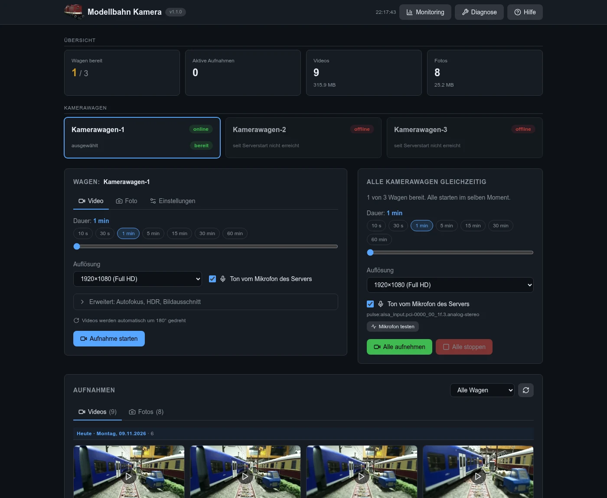
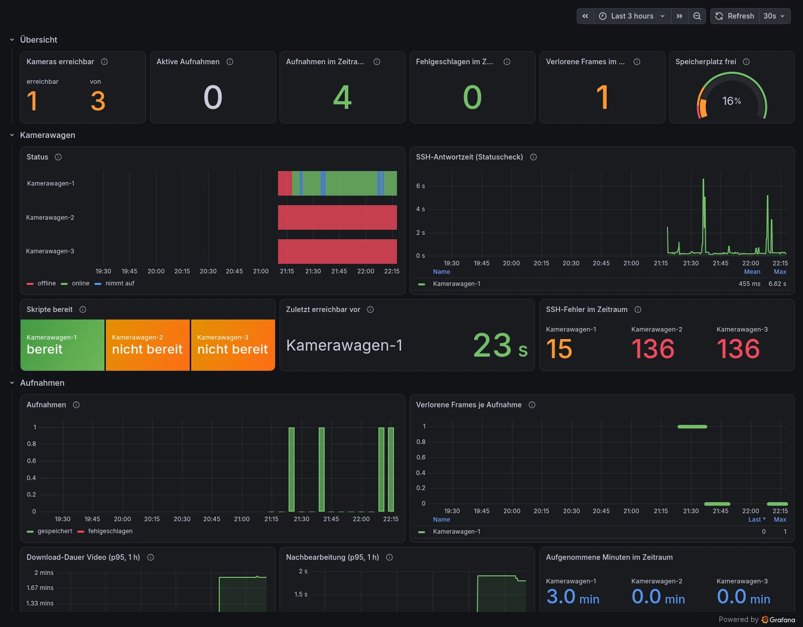
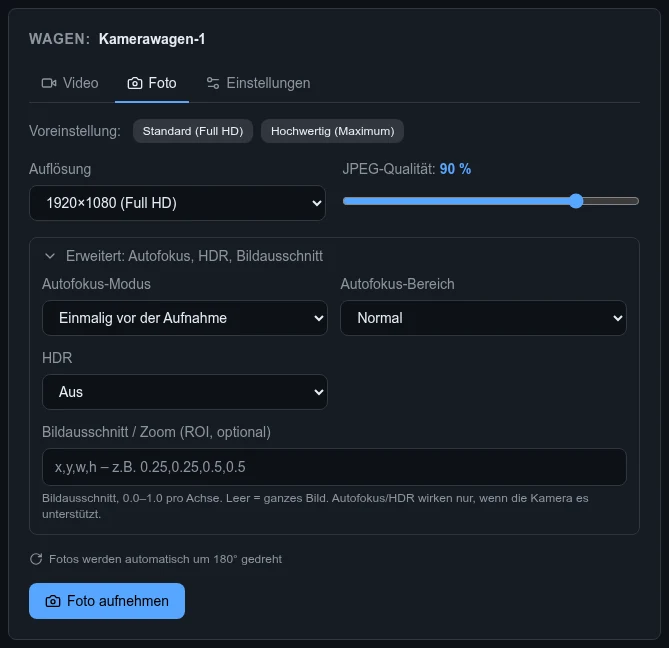
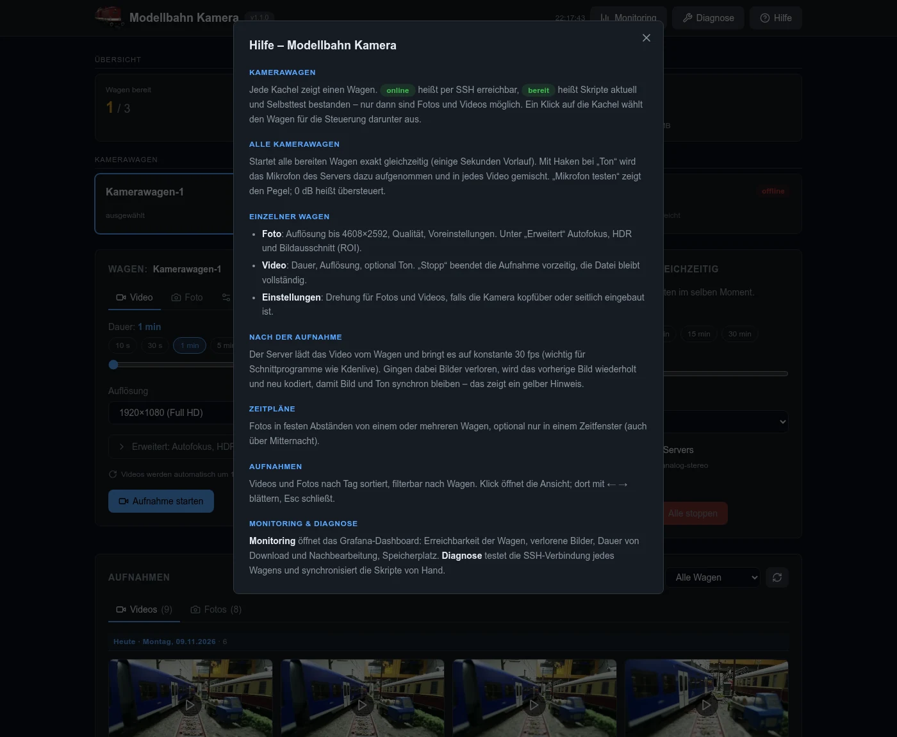
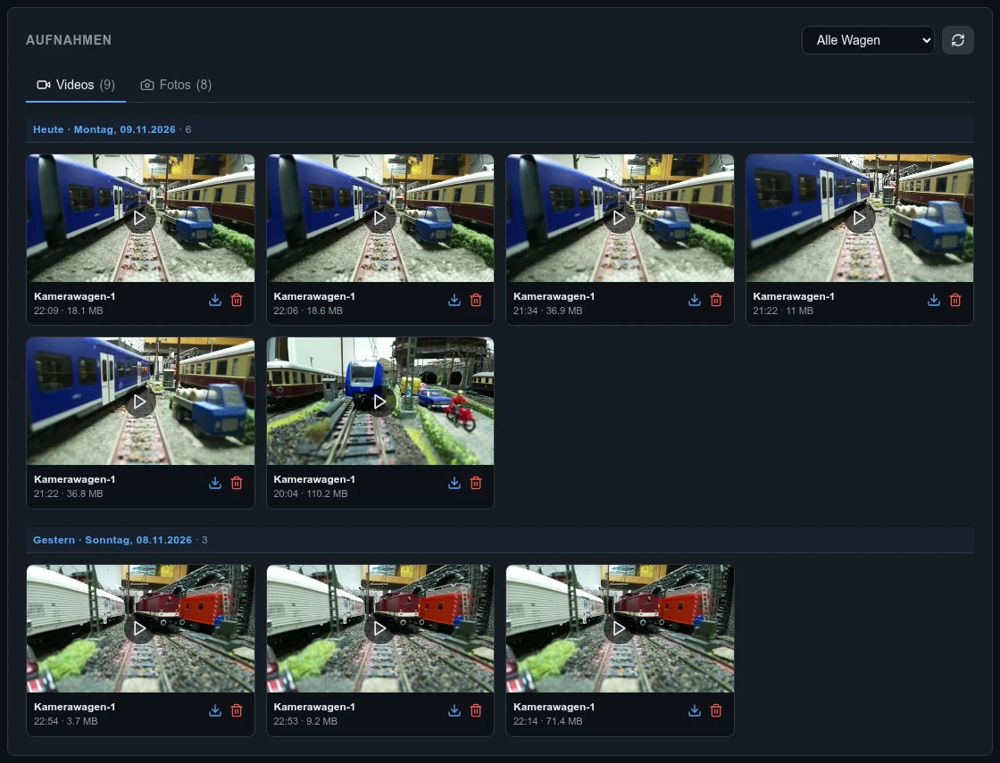
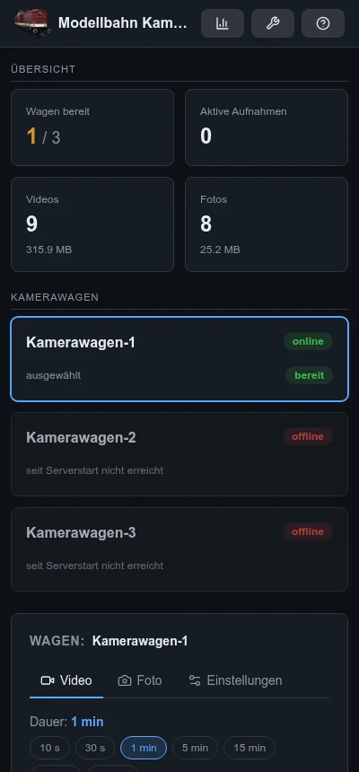
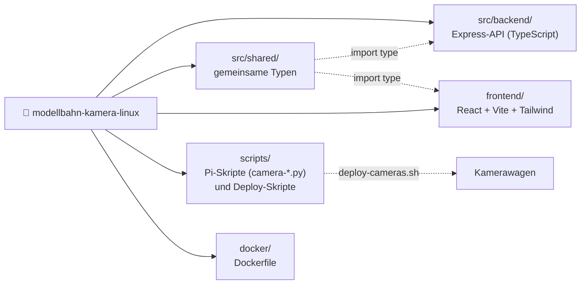

# Modellbahn Kamera Manager

Zentrale Web-Oberfläche für die Kamerawagen einer Modellbahn: mehrere Raspberry Pi Zero 2 W mit Kamera-Modul werden per SSH gesteuert. Der Manager läuft als Docker-Container auf einem PC (amd64) oder einem Raspberry Pi 5 (arm64).

- 📸 Fotos und 🎥 Videos pro Kamera auslösen, Video-Aufnahmen vorzeitig stoppen
- 🚂 Alle Kamerawagen gleichzeitig aufnehmen (synchroner Start, typ. < 30 ms Abweichung)
- 🎤 Ton vom Mikrofon des Servers (Laptop oder Pi 5) automatisch in die Videos gemischt
- ⏱️ Zeitpläne: alle 1–10 Minuten Fotos, optional nur in einem Zeitfenster (auch über Mitternacht), bleiben über Neustarts erhalten
- 🔄 Rotation pro Kamera (getrennt für Foto/Video), ROI/Zoom, Autofokus und HDR (Camera Module 3)
- 🗂️ Galerie mit Vorschaubildern, nach Tag gruppiert und nach Wagen filterbar, Großansicht für Fotos, Video-Player im Browser
- 🎞️ Videos mit konstanten 30 fps für Schnittprogramme wie Kdenlive; verlorene Bilder werden auf dem Server ausgeglichen
- 📊 Optionales Monitoring mit Prometheus und Grafana, direkt aus der Oberfläche erreichbar
- 🔄 Automatischer Abgleich der Kamera-Skripte: Nur Wagen mit Status „bereit“ dürfen aufnehmen
- 🔧 SSH-Diagnose mit Hinweisen zur Fehlerbehebung
- 🔐 Login per HTTP Basic Auth, Host-Key-Pinning für die SSH-Verbindungen

Aufbau und Datenfluss: siehe [ARCHITECTURE.md](ARCHITECTURE.md).



## Schnellstart

### 1. SSH-Schlüssel für die Kameras

Am besten ein eigener Schlüssel nur für die Kamerawagen:

```bash
ssh-keygen -t ed25519 -f ~/.ssh/kamera_ed25519 -N ''
ssh-copy-id -i ~/.ssh/kamera_ed25519.pub pi@192.168.1.101   # für jeden Pi
```

### 2. Konfiguration

```bash
cp .env.example .env                                  # SSH_KEY_FILE, AUTH_PASSWORD setzen
cp config/devices.json.example config/devices.json    # Kameras eintragen
```

Wichtige Einstellungen in `.env`:

| Variable | Bedeutung |
|---|---|
| `SSH_KEY_FILE` | Pfad zum privaten Kamera-Key **auf dem Host** (wird read-only in den Container gemountet) |
| `AUTH_USER` / `AUTH_PASSWORD` | Login für die Weboberfläche. Leer = kein Login (nicht empfohlen) |
| `HOST_PORT` | Port der Weboberfläche auf dem Host (Standard 8000) |
| `APP_UID` / `APP_GID` | Besitzer von `config/`, `data/` und dem Key (`id -u`, `id -g`) |
| `SSH_HOST_KEY_CHECK` | `tofu` (Standard): Host-Key beim ersten Kontakt merken, Änderungen ablehnen |
| `AUDIO_INPUT` | Mikrofon des Servers, z.B. `pulse:<quelle>` oder `alsa:plughw:1,0`. Leer = kein Ton |
| `COMPOSE_FILE` | Für Ton zusätzlich `docker-compose.audio-pulse.yml` (Laptop/Desktop) oder `docker-compose.audio-alsa.yml` (Pi 5) laden |
| `START_LEAD_SECONDS` | Vorlauf für „Alle aufnehmen“ (Standard 7 s) |
| `VFR_REENCODE` | `on` (Standard): Videos mit verlorenen Bildern auf dem Manager auf konstante Bildrate neu kodieren. `off`: variable Bildrate behalten |
| `VIDEO_CRF` / `VIDEO_PRESET` | Qualität und Tempo dieser Neukodierung (Standard `18` / `veryfast`) |
| `GRAFANA_ADMIN_PASSWORD` | Nur mit Monitoring-Overlay: Passwort für Grafana (Benutzer `admin`) |

### 3. Kamerawagen einrichten

```bash
make setup-cameras     # einmalig: Pakete installieren (sudo fragt nach dem Passwort)
```

Die Kameras werden aus `config/devices.json` gelesen (`jq` wird benötigt).

Die Kamera-Skripte selbst verteilt der Manager automatisch. Sie stecken im Docker-Image und werden bei der ersten Verbindung, nach jedem Wiederverbinden und alle 10 Minuten mit dem Stand auf dem Pi verglichen (`~/modellbahn-kamera-linux/scripts/.version`). Bei Abweichung lädt der Manager sie hoch und lässt danach einen Selbsttest auf dem Pi laufen (`camera-selfcheck.py`: picamera2, Kamera erkannt, Pillow, PyAV, ffmpeg). Nur Wagen mit Status **bereit** dürfen Fotos und Videos aufnehmen. Der Status steht in der Kameraliste, Details und ein Knopf zum manuellen Synchronisieren in der Diagnose. `make deploy-cameras` ist nur noch für Sonderfälle nötig.

### Optional: Mikrofon

Der Ton kommt vom Rechner, auf dem der Manager läuft, und wird nach der Aufnahme in jedes Video gemischt.

**Laptop/Desktop (PipeWire oder PulseAudio):**

```bash
pactl list sources short          # Name der Mikrofon-Quelle herausfinden
# in .env:
COMPOSE_FILE=docker-compose.yml:docker-compose.audio-pulse.yml
AUDIO_INPUT=pulse:alsa_input.pci-0000_00_1f.3.analog-stereo
```

**Raspberry Pi 5 mit USB-Mikrofon (ALSA):**

```bash
arecord -l                        # Karte/Gerät, z.B. card 1, device 0
getent group audio                # gid der audio-Gruppe
# in .env:
COMPOSE_FILE=docker-compose.yml:docker-compose.audio-alsa.yml
AUDIO_INPUT=alsa:plughw:1,0
AUDIO_GID=29
```

In der Oberfläche zeigt „Mikrofon testen“ den Pegel an. Liegt er bei 0 dB, ist der Eingang übersteuert: Eingangsverstärkung reduzieren, z.B. `pactl set-source-volume <quelle> 50%`.

### Optional: Monitoring (Prometheus + Grafana)

Prometheus sammelt alle 15 s die Messwerte des Managers, Grafana zeigt sie im Dashboard **Modellbahn Kamera**: Erreichbarkeit und SSH-Antwortzeit der Wagen, Aufnahmen pro Stunde, fehlgeschlagene Aufnahmen, verlorene Frames je Aufnahme, Download- und Nachbearbeitungsdauer, Speicherplatz, API-Anfragen sowie Arbeitsspeicher und CPU des Managers.

```bash
# in .env (lässt sich mit dem Audio-Overlay kombinieren):
COMPOSE_FILE=docker-compose.yml:docker-compose.audio-pulse.yml:docker-compose.monitoring.yml
GRAFANA_ADMIN_PASSWORD=<passwort>
```

Nach `make up`: Grafana unter <http://localhost:3001> (Benutzer `admin`, Port über `GRAFANA_PORT`). In der Weboberfläche führt der Knopf **Monitoring** in der Kopfleiste direkt zum Dashboard. Läuft Grafana unter einer anderen Adresse (z. B. hinter einem Reverse Proxy), diese als `GRAFANA_URL` in `.env` eintragen. Prometheus selbst ist nur lokal unter <http://127.0.0.1:9090> erreichbar. Die Daten bleiben 90 Tage bzw. bis 2 GB (`PROMETHEUS_RETENTION`, `PROMETHEUS_RETENTION_SIZE`).

Der Manager liefert die Metriken auf Port 9464 (`METRICS_PORT`, `0` = aus). Der Port ist nur im Compose-Netz sichtbar, nicht auf dem Host.

**Systemwerte der Pis (optional):** CPU-Temperatur, Last, Arbeitsspeicher, SD-Karte und WLAN-Verkehr erscheinen im eingeklappten Bereich „Raspberry Pis“, wenn auf den Wagen der node_exporter läuft:

```bash
sudo apt install prometheus-node-exporter        # auf jedem Pi
cp monitoring/prometheus/targets/pis.yml.example monitoring/prometheus/targets/pis.yml
# IPs eintragen – Prometheus liest die Datei ohne Neustart ein
```



Das Dashboard liegt in `monitoring/grafana/dashboards/modellbahn.json`. Änderungen in der Grafana-Oberfläche gehen beim Neustart verloren; zum Behalten das Dashboard als JSON exportieren und dort ablegen.

### 4. Manager starten

```bash
make up                # = docker compose up -d --build
```

Weboberfläche: <http://localhost:8000>

**Fertiges Image statt selbst bauen:** Für jede Version gibt es ein fertiges Image für amd64 und arm64 auf GitHub. Damit entfällt der Bau, was vor allem auf dem Raspberry Pi Zeit spart:

```bash
# in .env (lässt sich mit den Overlays für Ton und Monitoring kombinieren):
COMPOSE_FILE=docker-compose.yml:docker-compose.image.yml
MANAGER_TAG=1.2.0      # optional: feste Version. Standard ist latest (neuestes Release), main = Entwicklungsstand
```

Danach lädt `make up` das Image `ghcr.io/kamera-linux/modellbahn-kamera-linux`, statt es zu bauen. Ein erneutes `make up` holt eine neuere Version. Das Repository wird weiterhin gebraucht: für `.env`, `config/`, `data/` und `make setup-cameras`.

Auf dem Raspberry Pi 5 (Build direkt auf dem Pi):

```bash
make deploy-rpi5 RPI5_HOST=mein-pi5 RPI5_USER=pi   # rsync + docker compose up -d --build
```

`.env`, `config/devices.json` und `data/` auf dem Ziel bleiben dabei unverändert.

## Bedienung

Die Oberfläche ist von oben nach unten aufgebaut:

1. **Übersicht und Kamerawagen**: eine Kachel pro Wagen mit Status (online/offline/nimmt auf) und „bereit“. Ein Klick wählt den Wagen aus; beim Öffnen ist der erste bereite Wagen schon gewählt.
2. **Laufende Aufnahmen** mit Fortschritt, Startversatz und Hinweisen, z. B. zu verlorenen Bildern.
3. **Wagen** mit den Reitern Video, Foto und Einstellungen (Drehung) sowie **Alle Kamerawagen gleichzeitig**, beide mit Dauer-Schnellwahl von 10 s bis 60 min.
4. **Aufnahmen**: Videos und Fotos nach Tag, filterbar nach Wagen.
5. **Zeitpläne** für Fotos in festen Abständen.

In der Kopfleiste öffnet **Monitoring** das Grafana-Dashboard, **Diagnose** testet die SSH-Verbindungen und Skripte, **Hilfe** erklärt alle Bereiche.

<table>
  <tr>
    <td width="50%"></td>
    <td width="50%"></td>
  </tr>
  <tr>
    <td align="center">Foto-Reiter mit Autofokus, HDR und Bildausschnitt</td>
    <td align="center">Hilfe</td>
  </tr>
</table>



Auf dem Handy stehen alle Bereiche untereinander, die Kopfleiste zeigt nur Symbole:



## Daten

| Pfad | Inhalt |
|---|---|
| `data/photos/`, `data/videos/` | Aufnahmen (`<Kamera>_<UTC-Zeit>.jpg/.mp4`) |
| `data/thumbnails/` | Vorschaubilder (480 px), werden auf dem Pi erzeugt und beim Löschen mit entfernt |
| `data/schedules.json` | Zeitpläne |
| `data/known_hosts.json` | gemerkte SSH-Host-Keys. Nach einer Neuinstallation eines Pis dessen Eintrag löschen |
| `data/logs/` | Logs (rotierend, je 5 × 5 MB) |
| `config/devices.json` | Kameras und Rotation (wird beim Ändern der Rotation in der UI gespeichert) |

`data/`, `config/devices.json` und `.env` sind in `.gitignore`.

## API

Alle Endpunkte außer `/health` verlangen den Login, sofern `AUTH_PASSWORD` gesetzt ist. Eingaben werden validiert; ungültige Werte führen zu `400` mit Fehlermeldung.

| Methode | Pfad | Beschreibung |
|---|---|---|
| GET | `/health` | Healthcheck |
| GET | `/api/cameras` | Alle Kameras mit Status |
| GET | `/api/cameras/:id` | Eine Kamera |
| POST | `/api/cameras/:id/capture` | Foto: `{resolution, quality, autofocusMode, autofocusRange, hdr, roi}` |
| POST | `/api/cameras/:id/record/start` | Video: wie oben + `duration` (Sekunden, 1–3600), `audio` (true/false) |
| POST | `/api/cameras/:id/record/stop` | Laufende Aufnahme beenden (Datei bleibt gültig) |
| POST | `/api/cameras/:id/sync` | Kamera-Skripte neu übertragen und Selbsttest ausführen |
| POST | `/api/cameras/record/start-all` | Alle (oder `cameraIds`) gleichzeitig starten: `{duration, resolution, audio, …}` |
| POST | `/api/cameras/record/stop-all` | Alle laufenden Aufnahmen beenden |
| GET / POST | `/api/system/audio`, `/api/system/audio/test` | Mikrofon-Status / 1-s-Pegeltest |
| PUT | `/api/cameras/:id/rotation` | `{photoRotation, videoRotation}` (0/90/180/270) |
| GET/POST | `/api/schedules` | Zeitpläne auflisten / anlegen |
| PUT/DELETE | `/api/schedules/:id` | Zeitplan ändern (z.B. `{enabled: true}`) / löschen |
| GET | `/api/schedules/status/all` | Fortschritt, nächste Ausführung, letzter Fehler |
| GET | `/api/videos`, `/api/photos` | Dateilisten |
| GET/DELETE | `/api/videos/download/:file`, `/api/videos/:file` | Download / Löschen (analog `photos`) |
| GET | `/api/videos/view/:file`, `/api/videos/thumb/:file` | Inline-Ansicht (mit Range-Requests) / Vorschaubild (analog `photos`) |
| GET | `/api/videos/sessions` | Laufende und letzte Aufnahmen |
| POST | `/api/system/cameras/:id/test` | SSH-Diagnose (nur Kameras aus `devices.json`) |

Beispiel:

```bash
curl -u admin:PASSWORT -X POST http://localhost:8000/api/cameras/cam1/capture \
  -H 'Content-Type: application/json' -d '{"resolution":"1920x1080","quality":90}'
```

## Entwicklung

Voraussetzung: Node.js ≥ 20.

```bash
make install           # npm ci (Backend + Frontend)
make dev               # Backend :3000 (tsx watch) + Frontend :5173 (Vite, Proxy auf :3000)
make check             # Lint + Typecheck + Tests
```

Für `make dev` in `.env` zusätzlich `SSH_KEY_PATH=/home/<du>/.ssh/kamera_ed25519` setzen.

Projektstruktur:



## Release

Versionen nach [Semantic Versioning](https://semver.org/lang/de/): **patch** für Fehlerbehebungen, **minor** für neue Funktionen, **major** für inkompatible Änderungen. Änderungen kommen während der Entwicklung in [CHANGELOG.md](CHANGELOG.md) unter `[Unreleased]`.

```bash
make release-gh BUMP=minor TITLE="Zeitpläne für Videos"   # oder: Actions → Release → Run workflow
```

Der Workflow [release.yml](.github/workflows/release.yml) erledigt den Rest:

1. Lint, Typecheck und Tests
2. Version in `package.json`, `frontend/package.json` und den Lockfiles hochzählen (die Oberfläche zeigt sie oben neben dem Titel)
3. `[Unreleased]` im CHANGELOG zum Abschnitt der neuen Version machen. Ist er leer, werden die Commit-Nachrichten seit dem letzten Release eingetragen
4. Commit `release: vX.Y.Z – Titel` und Tag `vX.Y.Z` auf `main`
5. GitHub-Release mit den Notizen aus dem CHANGELOG
6. Docker-Images für amd64 und arm64: `ghcr.io/kamera-linux/modellbahn-kamera-linux:X.Y.Z`, `:X.Y` und `:latest` (jeder Push auf `main` baut zusätzlich `:main`)

Alternativ lokal mit Node.js: `make release BUMP=patch` legt Commit und Tag an, `git push origin main --follow-tags` stößt dann Schritt 5 und 6 an.

## Sicherheit

Der Manager ist für das Heimnetz gedacht und spricht nur HTTP. Nicht direkt ins Internet stellen. Für den Zugriff von unterwegs einen VPN-Zugang (z. B. WireGuard) oder einen Reverse Proxy mit HTTPS davorschalten.

- `AUTH_PASSWORD` immer setzen; ohne Passwort kann jeder im Netz Aufnahmen starten und löschen.
- Schreibende Anfragen (POST/PUT/DELETE) aus dem Browser werden nur von derselben Adresse angenommen. Eine fremde Webseite kann also keine Aufnahmen auslösen, auch wenn der Browser das Passwort gespeichert hat. Weitere erlaubte Adressen (z. B. ein eigenes Frontend) in `CORS_ORIGINS` eintragen.
- Der Kamera-Key wird nur lesend in den Container gemountet, der Container läuft ohne Root-Rechte, und SSH-Host-Keys werden beim ersten Kontakt gemerkt.
- Grafana ist im ganzen Netz erreichbar, Prometheus und die Metriken nur lokal bzw. im Compose-Netz.

Sicherheitslücken bitte nicht als öffentliches Issue melden, sondern über „Report a vulnerability“ im Reiter *Security* des Repositorys.

## Troubleshooting

- **Kamera „offline“**: In der UI die Diagnose öffnen und „Test SSH“ klicken. Manuell: `ssh -i ~/.ssh/kamera_ed25519 pi@<ip>`.
- **„Host key mismatch“** nach einer Neuinstallation des Pis: den Eintrag in `data/known_hosts.json` löschen.
- **Kamera nicht erkannt**: auf dem Pi `rpicam-hello --list-cameras`. In `/boot/firmware/config.txt` muss `camera_auto_detect=1` stehen oder ein passendes Overlay (z.B. `dtoverlay=imx708`).
- **Container „unhealthy“ / Schreibfehler**: `APP_UID`/`APP_GID` müssen zum Besitzer von `config/` und `data/` passen.
- **Logs**: `make logs` bzw. `data/logs/`.

## Lizenz

MIT, siehe [LICENSE](LICENSE)
